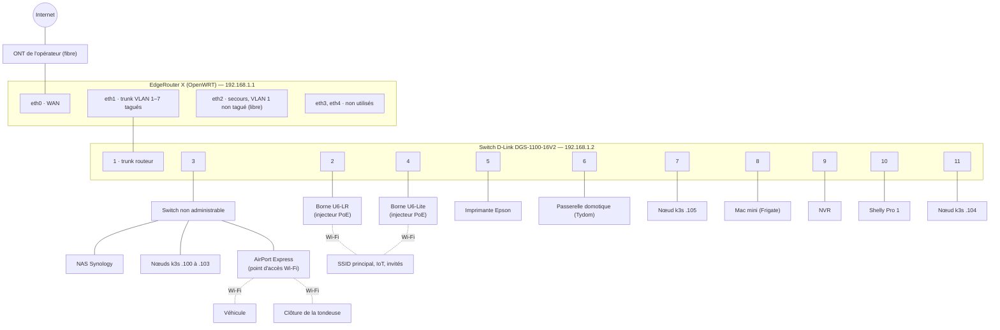

# Câblage réseau

Câblage physique relevé le 2026-11-17 : état des liens du routeur, table MAC du switch
D-Link croisée avec les baux DHCP et le contrôleur UniFi. Le plan des VLAN et la
migration sont dans `doc/vlan-migration.md` ; la configuration des ports du switch dans
`network/switch-checklist.md`. Aucune adresse MAC ici (dépôt public).

## Schéma

## Routeur (EdgeRouter X)

| Port   | Lien  | Branché                 | Configuration                               |
| ------ | ----- | ----------------------- | ------------------------------------------- |
| `eth0` | 1 G   | ONT de l'opérateur      | zone `wan`                                  |
| `eth1` | 1 G   | Switch D-Link, port 1   | trunk : VLAN 1 à 7 tagués                   |
| `eth2` | libre | Port de secours (câble) | VLAN 1 non tagué : brancher un portable ici |
| `eth3` | libre | —                       | membre de `br-lan`, d'aucun VLAN            |
| `eth4` | libre | —                       | membre de `br-lan`, d'aucun VLAN            |

Tout le trafic entre VLAN passe par `eth1` et le processeur du routeur.

## Switch D-Link DGS-1100-16V2

| Port    | Branché                                    | VLAN cible            | Remarque                                            |
| ------- | ------------------------------------------ | --------------------- | --------------------------------------------------- |
| 1       | Routeur `eth1`                             | 1 natif, 2 à 7 tagués | trunk                                               |
| 2       | Borne U6-LR                                | 1 natif, 2 à 7 tagués | trunk (SSID par VLAN, RADIUS)                       |
| 3       | Switch non administrable (voir ci-dessous) | 1                     | **ne jamais changer** : NAS et 4 nœuds k3s derrière |
| 4       | Borne U6-Lite                              | 1 natif, 2 à 7 tagués | trunk                                               |
| 5       | Imprimante Epson                           | 6                     | une seule MAC sur le port                           |
| 6       | Passerelle domotique (Tydom)               | 6                     | une seule MAC sur le port                           |
| 7       | Nœud k3s `192.168.1.105`                   | 1                     |                                                     |
| 8       | Mac mini (serveur, Frigate) `192.168.1.90` | 1                     |                                                     |
| 9       | NVR                                        | 5                     | une seule MAC sur le port                           |
| 10      | Shelly Pro 1                               | 6                     | une seule MAC sur le port                           |
| 11      | Nœud k3s `192.168.1.104`                   | 1                     |                                                     |
| 12 à 16 | Libres (aucune MAC vue)                    | —                     |                                                     |

Avec ce firmware, les 16 ports sont en trunk (VLAN 1 natif, 2 à 4094 tagués) tant qu'ils
ne sont pas passés en mode access. Avant de passer un port en access, vérifier dans la
table MAC qu'il ne porte qu'une adresse : un switch non administrable derrière passerait
tout entier dans le nouveau VLAN.

## Switch non administrable (port 3)

| Appareil                      | IP              | Remarque                             |
| ----------------------------- | --------------- | ------------------------------------ |
| NAS Synology                  | `192.168.1.10`  |                                      |
| Nœuds k3s                     | `.100` à `.103` |                                      |
| AirPort Express du véhicule   | `192.168.1.176` | diffuse son propre Wi-Fi, hors UniFi |
| Véhicule (Wi-Fi de l'AirPort) | `192.168.1.119` | invisible dans UniFi                 |
| Clôture de la tondeuse (idem) | `192.168.1.142` | invisible dans UniFi                 |

Conséquence : le véhicule et la clôture ne peuvent être déplacés ni par le port (le NAS
et le cluster sont sur le même), ni par RADIUS (ils ne passent pas par UniFi). Voir
« Questions ouvertes » dans `doc/vlan-migration.md`.

## Bornes Wi-Fi

| Borne   | Port du switch | IP (actuelle → cible) | Alimentation  |
| ------- | -------------- | --------------------- | ------------- |
| U6-LR   | 2              | `1.140` → `1.4`       | injecteur PoE |
| U6-Lite | 4              | `1.141` → `1.5`       | injecteur PoE |

Le switch n'est pas PoE. Les deux bornes diffusent les trois SSID ; le VLAN de chaque
client est choisi par SSID, ou par RADIUS pour les exceptions.

## À compléter

- Emplacement physique de chaque élément (baie, pièces) et correspondance avec le
  tableau de brassage (`doc/networking-wiring.puml`, squelette sans liaisons).
- Emplacement du switch non administrable et de l'AirPort Express.
