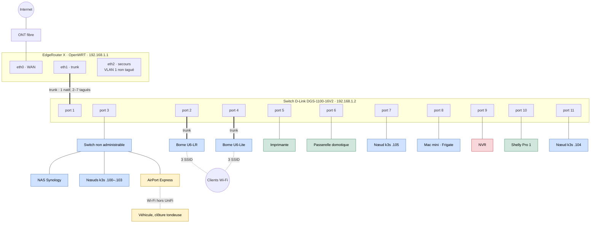
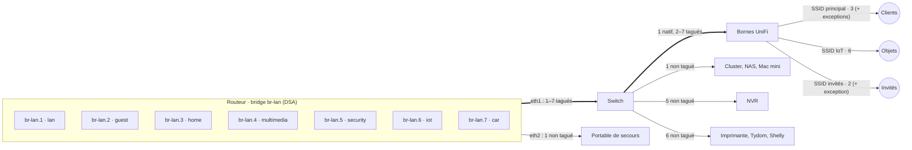
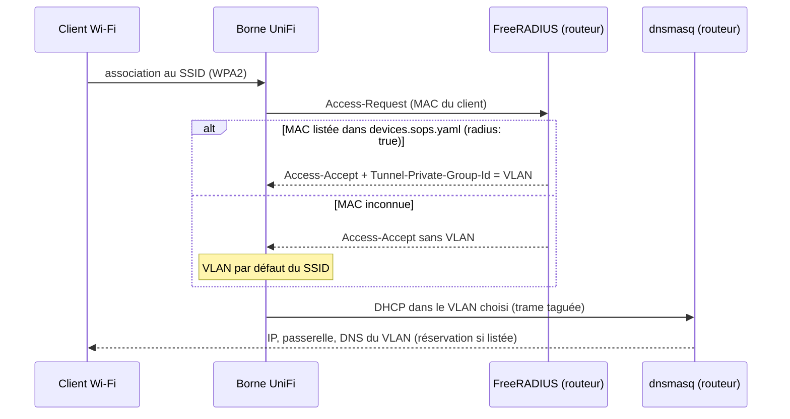
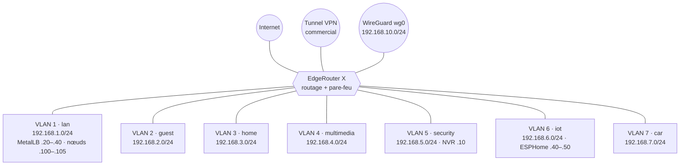
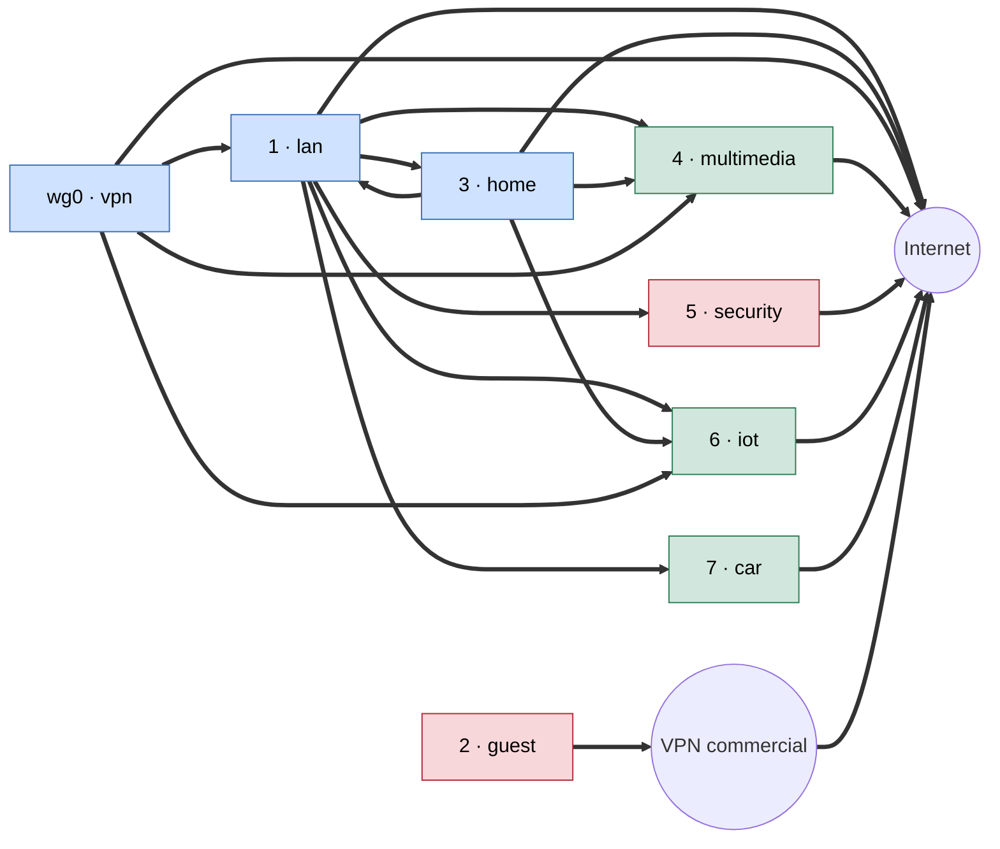
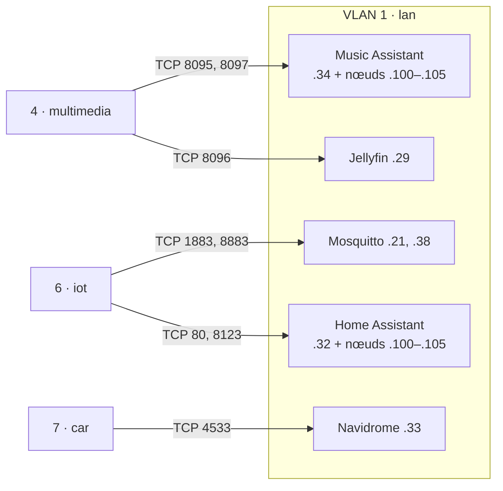
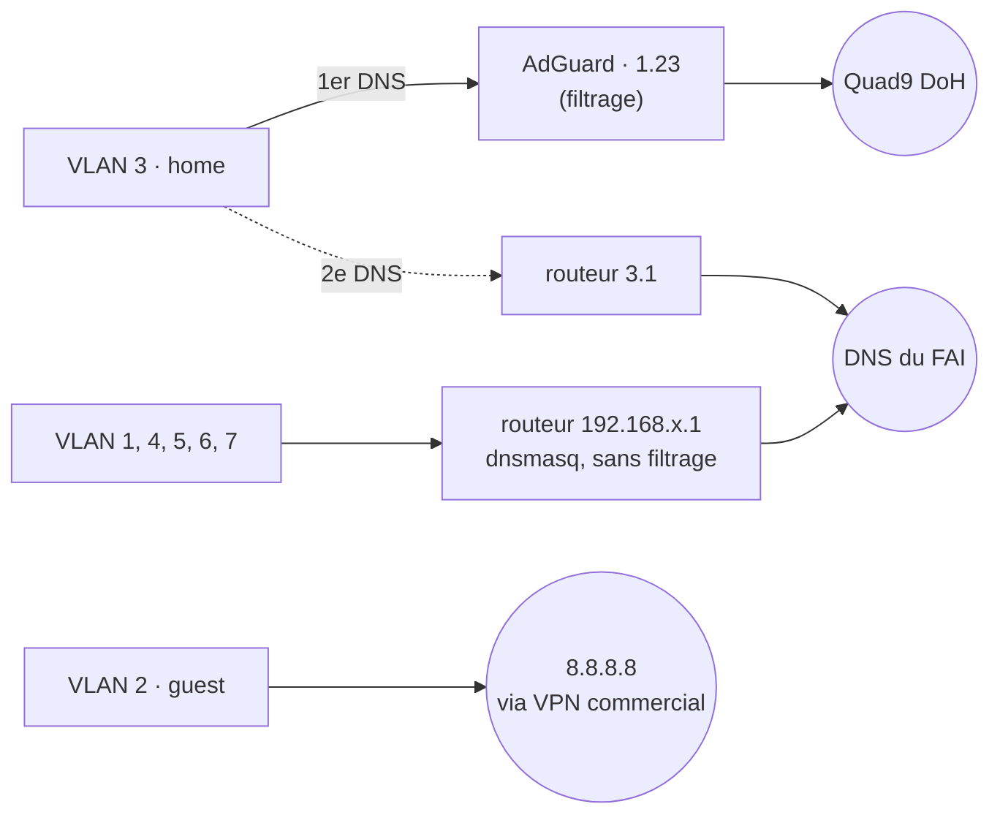
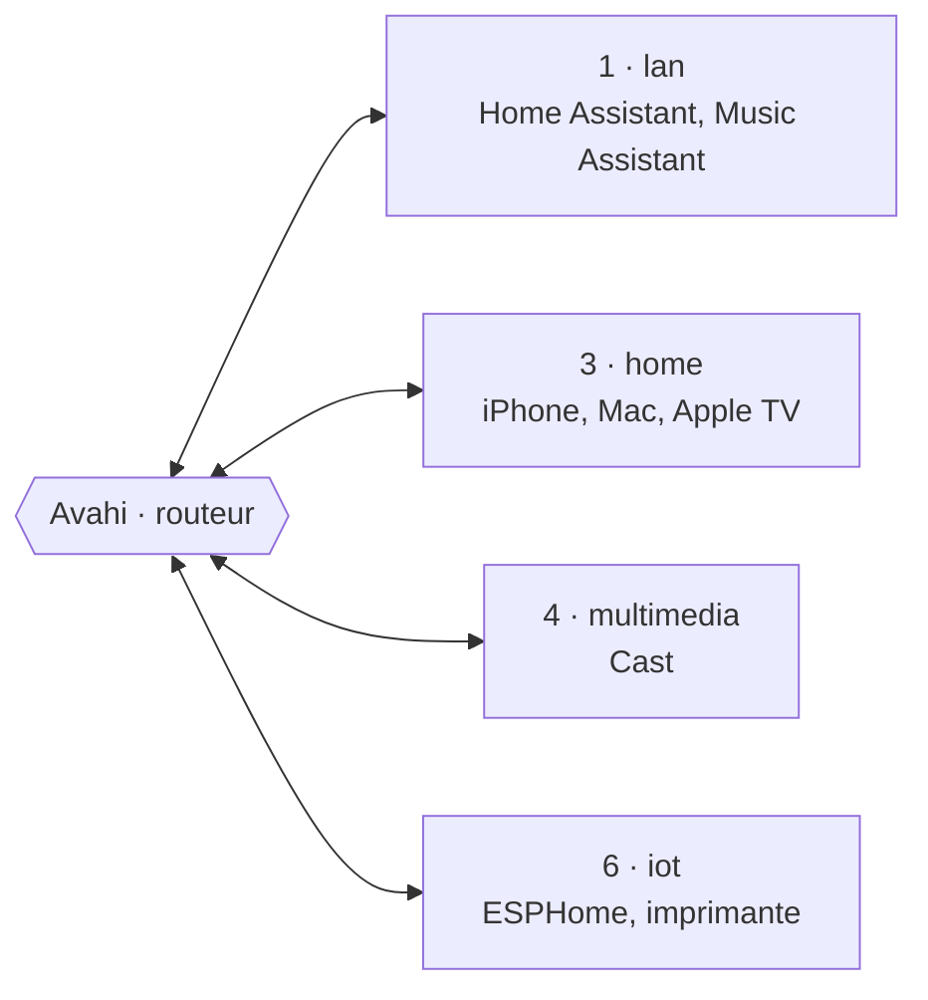

# Architecture réseau : physique, VLAN, pare-feu

Description de référence du réseau après la migration VLAN : câblage, transport des VLAN,
affectation des clients, adressage, DNS, mDNS et règles de pare-feu entre VLAN. Relevé
sur le routeur le 2026-11-17 (`uci show`, sans clés).

- Plan déclaratif (VLAN, transferts, règles) : [`plan.yaml`](plan.yaml), traduit en `uci`
  par [`openwrt/generate.py`](openwrt/generate.py).
- Historique, décisions et inventaire : [`doc/vlan-migration.md`](../doc/vlan-migration.md).
- Ports détaillés du routeur et du switch : [`doc/network-cabling.md`](../doc/network-cabling.md).
- Aucune adresse MAC ici (dépôt public) : elles sont dans `devices.sops.yaml`.

## Vue d'ensemble

| VLAN | Zone         | Sous-réseau       | Rôle                                                           | Accès au VLAN 1           |
| ---- | ------------ | ----------------- | -------------------------------------------------------------- | ------------------------- |
| 1    | `lan`        | `192.168.1.0/24`  | Serveurs : cluster k3s, NAS, Mac mini, switch, bornes, MetalLB | —                         |
| 2    | `guest`      | `192.168.2.0/24`  | Invités de passage, Internet via un VPN commercial             | aucun                     |
| 3    | `home`       | `192.168.3.0/24`  | Mac, iPhone, iPad, PC, Apple TV                                | complet                   |
| 4    | `multimedia` | `192.168.4.0/24`  | Nest, Google Home, Chromecast                                  | Music Assistant, Jellyfin |
| 5    | `security`   | `192.168.5.0/24`  | NVR                                                            | aucun                     |
| 6    | `iot`        | `192.168.6.0/24`  | ESPHome, Shelly, aspirateurs, imprimante, objets cloud         | MQTT, Home Assistant      |
| 7    | `car`        | `192.168.7.0/24`  | Véhicule et ses accessoires (migration bloquée)                | Navidrome                 |
| —    | `vpn`        | `192.168.10.0/24` | WireGuard `wg0` (accès distant)                                | complet                   |

Dans chaque VLAN : `.1` passerelle (routeur), `.2`–`.149` adresses fixes et réservations
DHCP, `.150`–`.250` pool DHCP dynamique (VLAN 1 : resserré à la phase 6).

## Physique

Un seul lien trunk relie le routeur au switch : tout le trafic entre VLAN passe par `eth1`
et le processeur de l'EdgeRouter X. Couleur d'un appareil = son VLAN.

| Port du switch | Mode                                   | Appareil                                 |
| -------------- | -------------------------------------- | ---------------------------------------- |
| 1              | trunk, 1 natif, 2–7 tagués             | Routeur `eth1`                           |
| 2, 4           | trunk, 1 natif, 2–7 tagués             | Bornes U6-LR, U6-Lite (injecteurs PoE)   |
| 3, 7, 8, 11    | trunk (1 natif) : à passer en access 1 | Cluster, NAS, Mac mini                   |
| 5, 6, 10       | access VLAN 6                          | Imprimante, passerelle domotique, Shelly |
| 9              | access VLAN 5                          | NVR                                      |
| 12–16          | trunk, libres                          | —                                        |

L'AirPort Express (VLAN 7 visé) est derrière le switch non administrable du port 3,
partagé avec le NAS et le cluster : ses clients ne peuvent être déplacés ni par le port ni
par RADIUS. Voir « Questions ouvertes » de `doc/vlan-migration.md`.

## Transport des VLAN (niveau 2)

Le routeur envoie le VLAN 1 tagué sur `eth1` ; le switch le reçoit sur le port 1 et le
redistribue non tagué (VLAN natif). Les switchs et les bornes restent administrés dans le
VLAN 1, avec le contrôleur UniFi du cluster (`192.168.1.22`).

## Affectation Wi-Fi : VLAN par SSID et par MAC

Les trois SSID d'origine sont gardés (nom et clé) : aucun objet n'est réappairé. Chaque
SSID a un VLAN par défaut ; FreeRADIUS sur le routeur (MAC Authentication) en impose un
autre à certaines adresses MAC.

| SSID      | VLAN par défaut | Exceptions par MAC (RADIUS)                                          |
| --------- | --------------- | -------------------------------------------------------------------- |
| Principal | 3 `home`        | Google / Chromecast → 4, OctoPrint et objets cloud → 6, véhicule → 7 |
| IoT       | 6 `iot`         | aucune                                                               |
| Invités   | 2 `guest`       | un objet cloud → 6                                                   |

- Les appareils Apple restent dans le VLAN par défaut du SSID principal : leur adresse
  Wi-Fi privée peut rester active.
- Un changement de VLAN ne s'applique qu'à la reconnexion (`unifi/unifi.py kick <MAC>`).
- Si FreeRADIUS tombe, plus aucune connexion n'est acceptée sur les SSID en MAC Auth :
  sonde `radius-probe` et alerte `RadiusDown`, secours `unifi.py mac-auth "<SSID>" off`.

## Adressage (niveau 3)

Réservations notables (toutes en DHCP, rien n'est saisi sur les appareils) :

| VLAN | Plage / adresse    | Appareils                                                 |
| ---- | ------------------ | --------------------------------------------------------- |
| 1    | `.2`, `.10`, `.90` | Switch, NAS, Mac mini                                     |
| 1    | `.20`–`.40`        | IP MetalLB des services du cluster                        |
| 1    | `.100`–`.105`      | Nœuds k3s                                                 |
| 3    | `.10`              | Apple TV (concentrateur HomeKit)                          |
| 4    | `.10`–`.16`        | Nest, Google Home, Chromecast, Nest Hub                   |
| 5    | `.10`              | NVR                                                       |
| 6    | `.40`–`.50`        | ESPHome (dernier octet conservé de l'ancien `1.4x`)       |
| 6    | `.45`, `.60`–`.68` | Shelly, objets cloud, aspirateurs, OctoPrint, imprimante… |

## Pare-feu entre VLAN

Politique par défaut : **refus** entre zones (`forward=REJECT`), retour des flux autorisé
par suivi d'état (une réponse passe toujours). Une zone ne parle à une autre que par un
transfert complet (`forwarding`) ou par une règle ciblée (`rule` : IP et ports).

Les services du cluster qui initient des flux sortent avec **l'IP de leur nœud**
(`.100`–`.105`), pas leur IP MetalLB : Home Assistant et Music Assistant (`hostNetwork`),
Scrypted, go2rtc. Le VLAN 1 a de toute façon un accès complet aux autres VLAN.

### Transferts complets

Zones de confiance (bleu) : `lan`, `home`, `vpn`. Zones restreintes (vert) : Internet
plus quelques services du VLAN 1. Zones isolées (rouge) : Internet seulement.

### Règles ciblées vers le VLAN 1

| Règle (`plan.yaml`)                | Source     | Destination            | Ports TCP  | Usage                                   |
| ---------------------------------- | ---------- | ---------------------- | ---------- | --------------------------------------- |
| `multimedia-music-assistant-nodes` | multimedia | `1.100`–`.105`         | 8095, 8097 | Cast : flux audio de Music Assistant    |
| `multimedia-music-assistant`       | multimedia | `1.34`                 | 8095, 8097 | idem, IP MetalLB                        |
| `multimedia-jellyfin`              | multimedia | `1.29`                 | 8096       | Cast depuis Jellyfin                    |
| `iot-mqtt`                         | iot        | `1.21`, `1.38`         | 1883, 8883 | Mosquitto (ESPHome, objets domotiques…) |
| `iot-home-assistant`               | iot        | `1.32`, `1.100`–`.105` | 80, 8123   | Objets qui poussent vers Home Assistant |
| `car-navidrome`                    | car        | `1.33`                 | 4533       | Musique du véhicule                     |

### Matrice des flux

Lecture : ligne = source, colonne = destination. ✅ tout, 🔸 règles ciblées, ❌ refusé.

| Source ↓ / Dest. → | lan | home | guest | multimedia | security | iot | car | Internet           |
| ------------------ | --- | ---- | ----- | ---------- | -------- | --- | --- | ------------------ |
| **lan (1)**        | —   | ✅   | ❌    | ✅         | ✅       | ✅  | ✅  | ✅                 |
| **home (3)**       | ✅  | —    | ❌    | ✅         | ❌       | ✅  | ❌  | ✅                 |
| **vpn (wg0)**      | ✅  | ❌   | ❌    | ✅         | ❌       | ✅  | ❌  | ✅                 |
| **guest (2)**      | ❌  | ❌   | —     | ❌         | ❌       | ❌  | ❌  | via VPN commercial |
| **multimedia (4)** | 🔸  | ❌   | ❌    | —          | ❌       | ❌  | ❌  | ✅                 |
| **security (5)**   | ❌  | ❌   | ❌    | ❌         | —        | ❌  | ❌  | ✅                 |
| **iot (6)**        | 🔸  | ❌   | ❌    | ❌         | ❌       | —   | ❌  | ✅                 |
| **car (7)**        | 🔸  | ❌   | ❌    | ❌         | ❌       | ❌  | —   | ✅                 |

Conséquences :

- Le VLAN 5 n'est joignable que depuis le VLAN 1 (Frigate sur le Mac mini, go2rtc) : ni
  `home` ni le VPN n'atteignent le NVR ; son accès distant passe par le cloud du fabricant.
- `home` pilote les objets (`iot`, `multimedia`) directement ; l'inverse est refusé.
- Le VPN WireGuard a les droits de `home`, sauf vers `home` lui-même. Il garde ses alias
  (DNAT `10.50.1.x` vers le NAS, le DNS du routeur et Traefik).

### Accès au routeur lui-même (`input`)

| Zone            | Politique | Autorisé                                        |
| --------------- | --------- | ----------------------------------------------- |
| lan, home, vpn  | accepter  | tout, dont l'administration (SSH, LuCI)         |
| guest           | refuser   | DHCP (UDP 67), DNS (53)                         |
| multimedia, iot | refuser   | DHCP, DNS, ICMP echo, mDNS (UDP 5353 multicast) |
| security, car   | refuser   | DHCP, DNS, ICMP echo                            |
| wan             | refuser   | règles OpenWRT par défaut (DHCP, ICMP, IGMP…)   |

### Entrées depuis Internet

| Redirection | Protocole / port | Destination           |
| ----------- | ---------------- | --------------------- |
| WireGuard   | UDP 51820        | routeur (`wg0`)       |
| Soulseek    | TCP 50300        | slskd, `192.168.1.36` |

Les redirections Traefik 80/443 sont désactivées : l'exposition web passe par le tunnel
Cloudflare (sortant).

## DNS

- Seul le VLAN 3 (`adguard: true` dans `plan.yaml`) reçoit AdGuard : les objets ne cassent
  pas sur un domaine bloqué (cas d'un objet cloud qui ne téléchargeait plus son contenu), et
  les VLAN 4 à 7 n'ont aucun accès à AdGuard.
- dnsmasq du routeur sert aussi les noms locaux en `.lan` (baux et réservations).
- Le multimedia utilise parfois des DNS Google codés en dur : autorisés (Internet ouvert).

## mDNS

Avahi (`avahi-nodbus-daemon`) relaie le mDNS entre les VLAN 1, 3, 4 et 6 : Cast, AirPlay,
HomeKit, imprimante. Le relais rend la **découverte** visible entre ces quatre VLAN ; le
**trafic** reste soumis au pare-feu ci-dessus. Pas de relais pour les VLAN 2, 5 et 7.

## Points ouverts

- Ports d'accès du switch (cluster, NAS, Mac mini) encore en trunk : un appareil
  compromis peut y envoyer des trames taguées dans n'importe quel VLAN sans passer par
  le pare-feu (durcissement en fin de migration, `switch-checklist.md`).
- Groupe `car` non migré (AirPort Express sur le port 3).
- Internet du VLAN 6 encore ouvert (« à restreindre » dans le plan).
